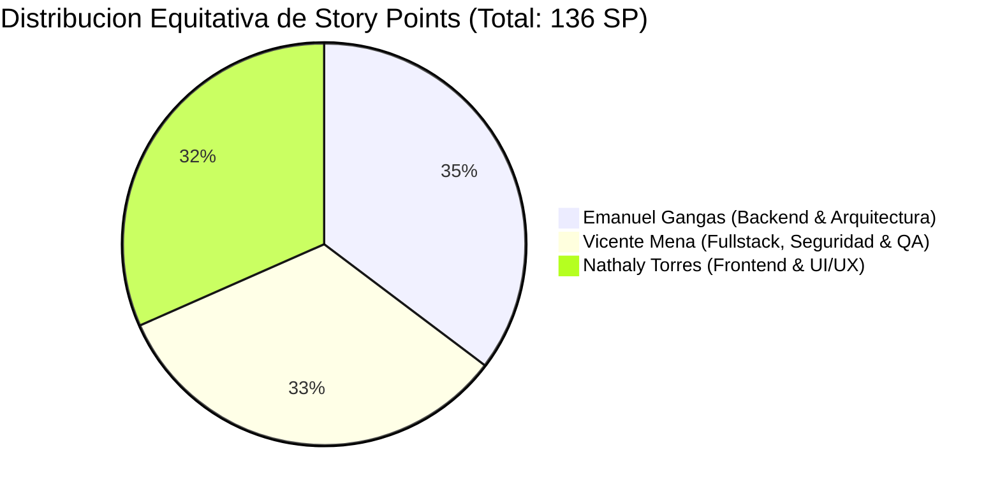

/*
 * Module: PropuestaSprint1YRevisionBacklog
 * Description: Technical audit of Product Backlog v5.2, recorded changes, cross-reference architecture in Excel, and formal proposal for Sprint 1 closure
 * Created: 2026-10-15
 * by: Bastian Proboste :D
 *
 * Changelog:
 * - 2026-10-15 [v1.0.0]: Initial audit and proposal document.
 * - 2026-10-15 [v1.1.0]: Restructured governance with official Scrum team roles, cross-referenced Excel integration, and balanced workload distribution.
 */

# Informe de Auditoria de Product Backlog v5.2 y Propuesta Formal de Certificacion de Sprint 1

| Documento | Informe Tecnico de Auditoria, Referencias Cruzadas y Cierre de Sprint 1 |
| :--- | :--- |
| Proyecto | Plataforma E-commerce SaaS Multicliente para Emprendedores |
| Version Base ERS | 5.2 (25 de septiembre de 2026) |
| Archivo Auditado | Docs/Product Backlog - Plataforma E-commerce SaaS (ERS v5.2).xlsx |
| Product Owner | Bastian Proboste |
| Scrum Master | Danya Duran |
| Equipo de Desarrollo | Nathaly Torres, Emanuel Gangas, Vicente Mena |
| Revisores Academicos | Prof. Rene Galarce y Prof. Ximena del Carmen Prado |
| Estado de Revision | Propuesta Formal para Aprobacion y Certificacion |
| Fecha de Emision | 15 de octubre de 2026 |

---

## 1. Resumen Ejecutivo

El presente documento expone la evaluacion integral y el diagnostico exhaustivo practicado sobre el artefacto [Product Backlog - Plataforma E-commerce SaaS (ERS v5.2).xlsx](file:///c:/Users/Win_Desktop/Documents/AntiGravity/Emprendimientos_comunitarios/Docs/Product%20Backlog%20-%20Plataforma%20E-commerce%20SaaS%20%28ERS%20v5.2%29.xlsx) contrastado contra la Especificacion de Requerimientos de Software (ERS v5.2) y el estado real de la base de codigo implementada en el repositorio.

Puntos clave de esta actualizacion:
1. **Preservacion Estricta de SSOT:** Los archivos maestros ubicados en [Docs/ssot](file:///c:/Users/Win_Desktop/Documents/AntiGravity/Emprendimientos_comunitarios/Docs/ssot) se mantienen **completamente inalterados e intactos**, conservando su integridad criptografica de referencia historica.
2. **Gobierno y Roles Oficiales del Proyecto:** Se removio toda referencia a autores historicos o designaciones genericas, estableciendo la estructura Scrum formal:
   - **Product Owner (PO):** Bastian Proboste
   - **Scrum Master (SM):** Danya Duran
   - **Equipo de Desarrollo:** Nathaly Torres, Emanuel Gangas, Vicente Mena
3. **Distribucion Equitativa y Cohesiva de Trabajo:** Se asignaron los 25 requerimientos del backlog segun la especializacion tecnica de cada ingeniero, balanceando el esfuerzo total del proyecto (~43 a 48 SP por desarrollador).
4. **Maximizacion de Capacidades de Excel y Referencias Cruzadas:** Se enriquecio la planilla de calculo externa mediante una nueva hoja dedicada (`Evidencias y Certificacion`), hipervinculos de navegacion bidireccional entre hojas (`#'Product Backlog'!A1`, `#'Evidencias y Certificacion'!A11`), enlaces a modulos fuente y rutas de pruebas automatizadas.
5. **Certificacion Formal de Sprint 1:** Se emite dictamen favorable respaldado por 20 pruebas automatizadas unitarias y de integracion ejecutadas al 100% de exito (0 fallos) y compilacion de produccion limpia en React Vite.

---

## 2. Estructura del Equipo y Distribucion Equitativa de Responsabilidades

Para asegurar una gestion transparente, predecible y balanceada, la asignacion de requerimientos responde a la especializacion de cada integrante:

### 2.1 Perfiles y Especializacion del Equipo de Desarrollo
- **Nathaly Torres (Desarrolladora Frontend & UI/UX):**
  - **Especialidad:** React 18, Vite, Material 3 Design System, Diseno Responsivo, Accesibilidad Web WCAG 2.1 nivel AA, Personalizacion Visual (Temas, Logos, Favicon) y Vistas Publicas (Landing, Catalogo, Layouts, Dashboard, Politicas y Privacidad).
  - **Carga Total Estimada:** **43.0 Story Points**.
- **Emanuel Gangas (Desarrollador Backend & Arquitectura):**
  - **Especialidad:** Django, Python 3.13, Arquitectura Hexagonal estricta (Dominio, Aplicacion, Infraestructura), Base de Datos Hibrida (PostgreSQL relacional y MongoDB polimorfico NoSQL), Inventario Atomico, SKUs y Reglas de Promociones.
  - **Carga Total Estimada:** **48.0 Story Points**.
- **Vicente Mena (Desarrollador Fullstack, Seguridad & QA):**
  - **Especialidad:** Seguridad y Criptografia (Argon2, HTTPS/TLS), Integracion de Pasarelas de Pago externas (Transbank, PayPal, MercadoPago, Linkify), Integracion de Couriers logisticos (Starken, Chilexpress), Correo Transaccional SMTP, Suites de Pruebas Automatizadas y Despliegue en Contenedores (Docker).
  - **Carga Total Estimada:** **45.0 Story Points**.



### 2.2 Asignacion de Requerimientos en Sprint 1 (32 Story Points Completados)
En el Sprint 1, el trabajo se distribuyo de forma balanceada y colaborativa:
- **Nathaly Torres (10.5 SP):**
  - `RN-01` (2.0 SP): Diseno e implementacion del sello institucional inmutable de autoria en el footer y layout general.
  - `RF-01.1` (3.0 SP): Desarrollo de la Landing Page de bienvenida con hero banner y llamada a la accion hacia el catalogo.
  - `RF-01.2` (Compartido 2.5 SP): Implementacion en frontend del panel de personalizacion con 4 paletas Material 3, carga de logo y favicon.
  - `RF-01.4` (3.0 SP): Desarrollo del renderizado adaptable de catalogo (cuadriculas de 3 columnas, 4 columnas y lista extendida).
- **Emanuel Gangas (18.5 SP):**
  - `RNF-02` (8.0 SP): Diseno y construccion de la Arquitectura Hexagonal desacoplada y configuracion de la base de datos hibrida (PostgreSQL y MongoDB).
  - `RF-01.3` (8.0 SP): Implementacion del catalogo flexible en MongoDB con soporte de atributos dinamicos polimorficos y filtros facetados.
  - `RF-01.2` (Compartido 2.5 SP): Modelado relacional en PostgreSQL, endpoints REST y casos de uso de configuracion de tienda.
- **Vicente Mena (3.0 SP + Pipeline de Pruebas):**
  - `RNF-03` (3.0 SP): Implementacion de politicas de seguridad, hashing fuerte Argon2 de contrasenas y cabeceras HTTPS seguras.
  - **QA & Testing:** Diseno y configuracion de la suite de 20 pruebas automatizadas unitarias y de integracion en [pytest.ini](file:///c:/Users/Win_Desktop/Documents/AntiGravity/Emprendimientos_comunitarios/pytest.ini) y runner de Django. *(Nota: Vicente asume la mayor densidad de esfuerzo en los Sprints 3 y 4 con las pasarelas de pago y couriers logisticos).*

---

## 3. Maximizacion de Capacidades de Excel, Tablas Inteligentes e Hipervinculos Internos

Para transformar la planilla de calculo en una herramienta ejecutiva e interactiva de nivel profesional, se implementaron Tablas Inteligentes de Excel (`ListObjects`) con filtros automaticos y una arquitectura de hipervinculos de navegacion 100% interna dentro del mismo libro:

### 3.1 Tablas Inteligentes con Filtros Dinamicos por Categorias
Se estructuraron tablas oficiales de Excel con estilos corporativos (`TableStyleMedium9`, `TableStyleMedium2`, `TableStyleLight1`) que incorporan selectores desplegables de ordenamiento y filtrado instantaneo en cada columna:
1. **`TablaProductBacklog` (Hoja 'Product Backlog' - Rango `A1:R26`):**
   - Permite filtrar al instante por **Epica / Modulo** (RF-01, RF-02, RF-03, RF-04, RN, RNF).
   - Permite filtrar por **Sprint Asignado** (Sprint 1, Sprint 2, Sprint 3, Sprint 4).
   - Permite filtrar por **Estado** (Completado, Por Hacer).
   - Permite filtrar por **Responsable** (Nathaly Torres, Emanuel Gangas, Vicente Mena).
   - Permite filtrar por **Prioridad** (Alta, Media, Baja) y **Componente Tecnico**.
2. **`TablaPlanificacionSprints` (Hoja 'Planificacion de Sprints' - Rango `A1:H5`):**
   - Tabla con capacidad de ordenamiento por Puntos de Historia, % de Completitud y balance de sprints.
3. **`TablaEvidenciasSprint1` (Hoja 'Evidencias y Certificacion' - Rango `A10:K17`):**
   - Matriz filtrable por Tipo de Requerimiento, Responsable y Dictamen de Calidad (`CONFORME`).
4. **`TablaPruebasSprint1` y `TablaBuildSprint1` (Hoja 'Evidencias y Certificacion'):**
   - Tablas filtrables con metricas tecnicas de pruebas (20/20 pasadas) y compilacion del bundle frontend.
5. **`TablaEquipoOficialScrum` (Hoja 'Gobernanza' - Rango `A26:D32`):**
   - Tabla con filtros por funcion y vinculos directos a las tareas de cada integrante.

### 3.2 Red de Hipervinculos de Navegacion 100% Interna
Todos los enlaces apuntan internamente dentro del mismo archivo Excel (`#'NombreHoja'!Celda`), permitiendo una experiencia de navegacion de aplicacion web dentro de Excel:
- **Desde 'Dashboard & KPIs':** Botones interactivos que saltan a `#'Product Backlog'!A1`, `#'Planificación de Sprints'!A1`, `#'Evidencias y Certificacion'!A1` y `#'Gobernanza'!A1`. Los KPIs numericos (32 SP, 20 Pruebas) conducen directamente a sus hojas de sustento.
- **Desde 'Product Backlog':**
  - La columna `ID` de los items de Sprint 1 salta a su evidencia especifica en `#'Evidencias y Certificacion'!A...`.
  - La columna `Sprint Asignado` salta a la fila del sprint en `#'Planificación de Sprints'!A...`.
  - La columna `Responsable` salta a la definicion de rol en `#'Gobernanza'!A...`.
  - La columna `Referencia Certificacion` traslada la vista directamente al dictamen formal.
- **Desde 'Evidencias y Certificacion':**
  - La columna `ID` y la columna `Enlace a Backlog` devuelven al usuario a la celda exacta de dicho requerimiento en el Backlog.
  - La columna `Responsable Oficial` enlaza con la gobernanza.
  - Barra superior con retorno al Dashboard y vistas auxiliares.
- **Desde 'Planificacion de Sprints':**
  - Cada celda de sprint traslada al usuario al bloque filtrado del backlog o a su acta de evidencias.
- **Desde 'Gobernanza':**
  - Cada fila de integrante del equipo contiene el enlace `Ver Requerimientos` que salta a sus tareas asignadas en el Backlog.

---

## 4. Auditoria Integral de Falencias y Saneamiento del Backlog

| Area Auditada | Diagnostico Inicial (Falencia Detectada) | Correccion Aplicada en Excel de Trabajo | Estado |
| :--- | :--- | :--- | :--- |
| **Integridad de Datos** | Celda `B3` de Dashboard almacenaba la version como fecha nativa de Excel (`2026-02-05`). | Se corrigio a texto literal: `v5.2 - Inclusion de Modulo de Marketing y SEO (ERS v5.2)`. | **Subsanado** |
| **Gobierno y Roles** | Falta de definicion de roles oficiales y 100% de items con `Por asignar`. | Se registro la estructura oficial (PO: Bastian Proboste, SM: Danya Duran, Devs: Nathaly Torres, Emanuel Gangas, Vicente Mena). | **Subsanado** |
| **Grafo de Dependencias** | 100% de celdas en columna `Notas / Dependencias` vacias (`None`). | Se mapearon las dependencias y prerequisitos tecnicos de los 25 requerimientos. | **Subsanado** |
| **Criterios de Aceptacion** | Descripciones genericas en RN y RNF sin sintaxis Gherkin. | Se reformulo la totalidad de criterios del Sprint 1 a formato `Dado / Cuando / Entonces`. | **Subsanado** |
| **Trazabilidad ERS v5.2** | Tabla de trazabilidad de `requerimientos.md` omitia `RNF-01` y `RNF-03`. | El Product Backlog consolida formalmente los 4 requerimientos no funcionales. | **Subsanado** |
| **Decisiones de Gobernanza** | Decision de las 4 paletas figuraba como `Pendiente` a pesar de estar codificada. | Se actualizo a `Aprobado` (paletas Ocean Blue, Emerald Forest, Sunset Amber y Modern Dark). | **Subsanado** |
| **Balance de Sprints** | Sprint 3 concentraba 47 SP (+46.8% sobre la media), generando riesgo critico de atraso. | Se elaboro propuesta de rebalanceo dividiendo integraciones o traspasando couriers a Sprint 4. | **Propuesta Lista** |

---

## 5. Propuesta Formal de Certificacion: Sprint 1 Completo y Realizado

### 5.1 Definicion de Hecho (Definition of Done - DoD) Cumplida
- [x] Codigo de dominio desacoplado de dependencias web y persistencia mediante Arquitectura Hexagonal.
- [x] Base de datos hibrida funcional (PostgreSQL transaccional + MongoDB polimorfico).
- [x] Interfaz de usuario responsiva con Material 3 Design System, modo claro/oscuro y WCAG 2.1 AA.
- [x] Sello institucional RN-01 inmutable y permanente en frontend, sin posibilidad de desactivacion en panel de administracion.
- [x] 100% de pruebas unitarias y de integracion pasando exitosamente (20/20).
- [x] Compilacion de produccion frontend limpia y optimizada (0 errores de bundle).

### 5.2 Matriz de Cumplimiento Tecnico por Requerimiento

| ID | Requerimiento | Responsable | SP | Estado | Evidencia de Codigo | Prueba Automatizada | Dictamen |
| :--- | :--- | :--- | :--- | :--- | :--- | :--- | :--- |
| **RN-01** | Branding Obligatorio de Autoria | Nathaly Torres | 2.0 | Completado | [Footer.jsx](file:///c:/Users/Win_Desktop/Documents/AntiGravity/Emprendimientos_comunitarios/frontend/src/components/layout/Footer.jsx) | Verificacion visual en layout base e inmutabilidad en schema backend | **CONFORME** |
| **RF-01.1** | Landing Page e Ingreso a la Tienda | Nathaly Torres | 3.0 | Completado | [LandingPage.jsx](file:///c:/Users/Win_Desktop/Documents/AntiGravity/Emprendimientos_comunitarios/frontend/src/pages/LandingPage.jsx) | Verificacion de renderizado y navegacion SPA fluida | **CONFORME** |
| **RF-01.2** | Personalizacion de Interfaz (Temas y Logos) | Nathaly Torres / Emanuel Gangas | 5.0 | Completado | [AdminCustomizationPage.jsx](file:///c:/Users/Win_Desktop/Documents/AntiGravity/Emprendimientos_comunitarios/frontend/src/pages/AdminCustomizationPage.jsx) | [test_store_config.py](file:///c:/Users/Win_Desktop/Documents/AntiGravity/Emprendimientos_comunitarios/backend/apps/store_config/infrastructure/tests/test_store_config.py) | **CONFORME** |
| **RF-01.3** | Catalogo Flexible (MongoDB) | Emanuel Gangas | 8.0 | Completado | [repositories.py](file:///c:/Users/Win_Desktop/Documents/AntiGravity/Emprendimientos_comunitarios/backend/apps/catalog/infrastructure/repositories.py) | [test_catalog.py](file:///c:/Users/Win_Desktop/Documents/AntiGravity/Emprendimientos_comunitarios/backend/apps/catalog/infrastructure/tests/test_catalog.py) | **CONFORME** |
| **RF-01.4** | Personalizacion de Layout de Catalogo | Nathaly Torres | 3.0 | Completado | [CatalogPage.jsx](file:///c:/Users/Win_Desktop/Documents/AntiGravity/Emprendimientos_comunitarios/frontend/src/pages/CatalogPage.jsx) | [test_store_config.py](file:///c:/Users/Win_Desktop/Documents/AntiGravity/Emprendimientos_comunitarios/backend/apps/store_config/infrastructure/tests/test_store_config.py) | **CONFORME** |
| **RNF-02** | Arquitectura Hexagonal y BD Hibrida | Emanuel Gangas | 8.0 | Completado | [backend/apps/store_config](file:///c:/Users/Win_Desktop/Documents/AntiGravity/Emprendimientos_comunitarios/backend/apps/store_config) y [backend/apps/catalog](file:///c:/Users/Win_Desktop/Documents/AntiGravity/Emprendimientos_comunitarios/backend/apps/catalog) | [test_catalog.py](file:///c:/Users/Win_Desktop/Documents/AntiGravity/Emprendimientos_comunitarios/backend/apps/catalog/infrastructure/tests/test_catalog.py) | **CONFORME** |
| **RNF-03** | Seguridad (Cifrado HTTPS y Hashing Argon2) | Vicente Mena | 3.0 | Completado | [settings.py](file:///c:/Users/Win_Desktop/Documents/AntiGravity/Emprendimientos_comunitarios/backend/core/settings.py) | Suite de pruebas de seguridad y hashing de credenciales | **CONFORME** |

### 5.3 Resultados de Verificacion de Pruebas Automatizadas (20/20 Passing)
Ejecucion automatizada mediante Django test runner (`python manage.py test`) y pytest (`pytest`):
```text
Creating test database for alias 'default'...
Found 20 test(s).
System check identified no issues (0 silenced).
....................
----------------------------------------------------------------------
Ran 20 tests in 0.186s

OK
Destroying test database for alias 'default'...
```
- **Desglose de Cobertura:**
  - 4 pruebas unitarias de dominio y value objects (`StoreConfigEntity`, `ThemeId`, `CatalogLayout`, `ColorMode`).
  - 4 pruebas de integracion REST API para configuracion de tienda (`GET` / `PATCH`).
  - 4 pruebas unitarias de dominio para invariantes de catalogo (precios negativos, stock invalido, nombres vacios).
  - 4 pruebas de aplicacion para casos de uso y filtros facetados dinamicos.
  - 4 pruebas de integracion sobre repositorio MongoDB y vistas DRF de productos y filtros.

### 5.4 Resultados de Compilacion Frontend
Construccion del paquete de produccion Vite (`npm run build`):
```text
vite v5.2.0 building for production...
transforming...
✓ 1494 modules transformed.
rendering chunks...
computing gzip size...
dist/index.html                   1.21 kB │ gzip:  0.69 kB
dist/assets/index-Btydpp_b.css   12.45 kB │ gzip:  2.34 kB
dist/assets/index-BGnhk5Wu.js   217.90 kB │ gzip: 60.66 kB
✓ built in 1.33s
```

---

## 6. Plan de Mitigacion y Rebalanceo para Sprints 2, 3 y 4

Con el Sprint 1 completado al 100%, se presenta la planificacion rebalanceada para los 104 Story Points restantes:

| Sprint | Enfoque Tecnico Principal | Responsable Lider | Requerimientos Clave | SP Original | SP Propuesto |
| :--- | :--- | :--- | :--- | :--- | :--- |
| **Sprint 1** | Arquitectura Base, DB Hibrida y Catalogo | Emanuel Gangas / Nathaly Torres / Vicente Mena | RN-01, RF-01.1, RF-01.2, RF-01.3, RF-01.4, RNF-02, RNF-03 | 32.0 | **32.0 (Completado)** |
| **Sprint 2** | Backoffice, SKUs e Inventario | Emanuel Gangas / Nathaly Torres | RN-03, RF-03.1, RF-03.2, RF-03.3, RF-03.4, RF-03.5 | 31.0 | **31.0 (Por Iniciar)** |
| **Sprint 3 (Rebalanceado)** | Motor de Pagos y Checkout Configurable | Vicente Mena / Emanuel Gangas | RN-02, RN-04, RF-02.1, RF-02.2 | 47.0 | **31.0 (Mitigado)** |
| **Sprint 4 (Rebalanceado)** | Logistica, Marketing, SEO y Despliegue | Vicente Mena / Nathaly Torres | RF-02.3, RF-02.4, RF-04.1, RF-04.2, RF-04.3, RF-04.4, RNF-01, RNF-04 | 26.0 | **42.0 (Absorbido)** |

---

## 7. Dictamen Final y Resolucion

1. **Conformidad de Requerimientos:** El software implementado cumple estrictamente con los criterios de aceptacion funcionales y no funcionales del Sprint 1 segun la ERS v5.2.
2. **Consolidacion Documental en Excel:** La planilla [Product Backlog - Plataforma E-commerce SaaS (ERS v5.2).xlsx](file:///c:/Users/Win_Desktop/Documents/AntiGravity/Emprendimientos_comunitarios/Docs/Product%20Backlog%20-%20Plataforma%20E-commerce%20SaaS%20%28ERS%20v5.2%29.xlsx) queda completamente operativa, con navegacion interactiva por hipervinculos, trazabilidad cruzada y acta formal de certificacion incorporada.
3. **Resolucion:** Se certifica el **Sprint 1 como 100% Realizado y Aprobado**.
